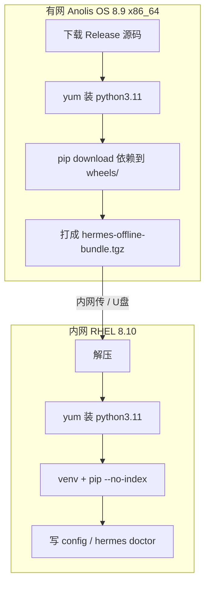

# Hermes Agent 内网部署指南（RHEL 8.10 / x86_64）

面向无法访问外网的目标机：在有网的 **Anolis OS 8.9** 上打包依赖，拷到内网 **RHEL 8.10** 用 yum Python + pip 安装。

| 角色 | 机器 | 说明 |
|------|------|------|
| **打包机（有网）** | Anolis OS 8.9，`5.10.134-*.an8.x86_64` | 主路径：本机 `pip download` 即可 |
| **目标机（内网）** | RHEL 8.10 (Ootpa)，`4.18.0-*.el8_10.x86_64` | yum 装 python3.11/3.12 + pip，**不必装 uv** |
| 可选 | 有网 macOS | 仅作备份；优先用 Anolis，避免 macOS wheel |

两台都是 **x86_64 + EL8 系 glibc**，ABI 兼容，Anolis 下的 Linux wheel 可直接用于 RHEL 8.10。

LLM / MCP 按文末配置模板自行填写即可。

---

## 0. 目标机要不要装 uv？

**不要。** 目标机有内网 yum 的 Python 3.11/3.12 时：

```text
yum 装 python3.11 → python3.11 -m venv → pip install --no-index --find-links=wheels
```

| 机器 | 工具 | 说明 |
|------|------|------|
| **目标机 RHEL** | **pip + venv** | 不必装 uv |
| **打包机 Anolis** | **pip**（有 python3.11 即可） | 本机下载 Linux wheels，不必 Docker、不必 uv |
| Mac（可选） | Docker `linux/amd64` 或交叉 `--platform` | 仅当 Anolis 不可用时 |

真正要带走的是：**Hermes Release 源码 + Linux x86_64 wheels**。

---

## 1. 用 Release 还是最新 git？

**结论：内网生产用官方 Release 标签，不要跟 `main`。**

| 来源 | 适用场景 | 说明 |
|------|----------|------|
| **Release 标签**（推荐） | 生产 / 内网 | 如 `v2026.7.7.2`，版本固定、可审计、可回滚 |
| `main` 最新提交 | 仅开发尝鲜 | 可能含未发布改动 |
| Docker 镜像 `nousresearch/hermes-agent` | 已有内网镜像仓 | `docker pull` → `save` → 内网 `load` |

Release 主要是 CalVer tag + changelog，**没有**完整离线安装包；仍需自备第三方 wheels。

```text
https://github.com/NousResearch/hermes-agent/releases/tag/v2026.7.7.2
https://github.com/NousResearch/hermes-agent/archive/refs/tags/v2026.7.7.2.tar.gz
```

```bash
# 在有网 Anolis 上查最新 tag
curl -fsSL https://api.github.com/repos/NousResearch/hermes-agent/releases/latest \
  | python3 -c "import sys,json; print(json.load(sys.stdin)['tag_name'])"
```

---

## 2. 整体流程（Anolis 打包 → RHEL 安装）



---

## 3. Anolis 打包机：制作离线包（主路径）

在 `dgvxl24429`（或任意能上网的 Anolis 8.9 x86_64）上操作。与目标机同架构，**直接 `pip download`，不要加 macOS 那套 `--platform` 交叉参数**。

### 3.1 系统准备

```bash
# 包名以你们 yum 源为准；需与目标机 Python 小版本一致（推荐都用 3.11）
sudo yum install -y python3.11 python3.11-pip python3.11-devel \
  git curl tar which gcc gcc-c++ make \
  openssl-devel libffi-devel

python3.11 --version
python3.11 -m pip install -U pip setuptools wheel
```

若 Anolis 上暂无 `python3.11`，可用 `python3.12`，但目标机必须同版本。

### 3.2 下载 Release 源码

```bash
export HERMES_TAG=v2026.7.7.2   # 换成选定的 Release
mkdir -p ~/hermes-build && cd ~/hermes-build

curl -fsSL -o hermes-agent-${HERMES_TAG}.tar.gz \
  "https://github.com/NousResearch/hermes-agent/archive/refs/tags/${HERMES_TAG}.tar.gz"
tar xzf hermes-agent-${HERMES_TAG}.tar.gz
mv hermes-agent-* hermes-agent
```

或：

```bash
git clone --depth 1 --branch "$HERMES_TAG" \
  https://github.com/NousResearch/hermes-agent.git
```

### 3.3 下载依赖 wheels

```bash
cd ~/hermes-build
mkdir -p wheels
cd hermes-agent

# Anolis 自带 pip 往往偏旧，download 不支持 -e，先升级
python3.11 -m pip install -U "pip>=24" setuptools wheel

# 【重要】构建依赖也要打进 wheels，否则目标机 --no-index 时装包会失败
# pyproject.toml 要求: setuptools>=77,<83
python3.11 -m pip download -d ../wheels "setuptools>=77,<83" wheel packaging

# 下载当前项目 + extras 的运行依赖（不要用 -e）
# 最小：.[mcp,cli]；要全量能力用 .[all]
python3.11 -m pip download -d ../wheels ".[all]"
```

公司 PyPI 镜像示例：

```bash
python3.11 -m pip download -d ../wheels "setuptools>=77,<83" wheel packaging ".[all]" \
  -i https://mirrors.example.com/pypi/simple
```

若仍报错，用「先装进临时 venv → freeze → download」兜底：

```bash
cd ~/hermes-build/hermes-agent
python3.11 -m venv /tmp/hermes-pack
source /tmp/hermes-pack/bin/activate
pip install -U "pip>=24" setuptools wheel
pip install ".[all]"
pip freeze | grep -vE '^-e |^hermes-agent==' > /tmp/hermes-reqs.txt
deactivate
python3.11 -m pip download -d ../wheels -r /tmp/hermes-reqs.txt
python3.11 -m pip download -d ../wheels "setuptools>=77,<83" wheel packaging
```

检查 wheels 里是否已有 setuptools（目标机装包必需）：

```bash
ls ../wheels | grep -i setuptools
ls ../wheels | grep -E 'macosx|win_amd64' || echo "OK: no mac/win wheels"
```

### 3.4 打成离线包并传到目标机

```bash
cd ~/hermes-build
tar czf hermes-offline-bundle.tgz hermes-agent wheels

# 例如 scp 到内网 RHEL（按你们通道改）
# scp hermes-offline-bundle.tgz user@dgvxl42826:~/
```

包内只需：**源码 + wheels**。不必带 uv，也不必带 Anolis 的整个 Python 安装树。

---

## 4. 目标机（RHEL 8.10）：yum Python + pip（无需 uv）

### 4.1 系统包（内网 yum/dnf）

**Python 小版本必须与 Anolis 打包时一致**（两边都用 3.11，或都用 3.12）。

```bash
sudo yum install -y python3.11 python3.11-pip python3.11-devel \
  git curl tar which gcc gcc-c++ make \
  openssl-devel libffi-devel bzip2-devel zlib-devel \
  readline-devel sqlite-devel

python3.11 --version
```

内网一般不需要浏览器；**不要**装 Playwright / Chromium，除非业务明确要 browser 工具。

### 4.2 解压并用 pip 离线安装

```bash
mkdir -p ~/hermes-offline && cd ~/hermes-offline
# 若包已解压在 /data01/hermes-build，可直接用该路径

python3.11 -m venv ~/.hermes/venvs/hermes
source ~/.hermes/venvs/hermes/bin/activate
python -m pip install -U pip

WHEELS=/data01/hermes-build/wheels   # 按实际路径改
SRC=/data01/hermes-build/hermes-agent

# 先装构建工具到当前 venv，再用 --no-build-isolation 装 Hermes
# （离线时 pip 默认隔离构建会再找 setuptools，wheels 里没有就会失败）
pip install --no-index --find-links="$WHEELS" "setuptools>=77,<83" wheel packaging

cd "$SRC"
pip install --no-index --find-links="$WHEELS" --no-build-isolation ".[all]"
# 若希望 editable（改源码即生效）：把 ".[all]" 换成 -e ".[all]"
```

### 4.3 初始化配置目录与命令

```bash
mkdir -p ~/.hermes/{cron,sessions,logs,memories,skills,skins}
cp cli-config.yaml.example ~/.hermes/config.yaml
touch ~/.hermes/.env

mkdir -p ~/.local/bin
ln -sf ~/.hermes/venvs/hermes/bin/hermes ~/.local/bin/hermes
echo 'export PATH="$HOME/.local/bin:$PATH"' >> ~/.bashrc
source ~/.bashrc

hermes --version
hermes doctor
```

---

## 5. 配置 LLM（自行填写）

接口需 **OpenAI 兼容**（`/v1/chat/completions`）。编辑 `~/.hermes/config.yaml`：

```yaml
model:
  provider: custom
  default: "<你的模型名>"              # 与推理服务 served-model-name 一致
  base_url: "http://<LLM主机>:<端口>/v1"  # 不要末尾斜杠
  api_key: "<密钥或任意非空占位>"
  context_length: 65536                 # Agent+工具建议 ≥ 64k，按实机改

# 可选：命名多个内网端点
# custom_providers:
#   - name: "corp-llm"
#     base_url: "http://10.x.x.x:8000/v1"
#     api_key: "..."
```

密钥也可放 `~/.hermes/.env`（仅密钥类）：

```bash
# 仅当走 openai-api provider 且用环境变量时需要；custom 一般写在 config.yaml
# OPENAI_API_KEY=...
```

交互式配置：`hermes model` → **Custom endpoint**。

**推理侧注意（常见踩坑）：**

- vLLM 需开启 tool calling：`--enable-auto-tool-choice` + `--tool-call-parser <模型对应解析器>`
- `base_url` 不要带尾 `/`
- 连通性自检：`curl -s http://<LLM>/v1/models`

---

## 6. 配置 MCP（自行填写）

编辑 `~/.hermes/config.yaml` 的 `mcp_servers`。

### HTTP（内网 MCP 推荐）

```yaml
mcp_servers:
  corp_mcp:
    url: "http://<MCP主机>:<端口>/mcp"
    headers:
      Authorization: "Bearer <token>"
    timeout: 120
    connect_timeout: 60
    tools:
      include: [<工具名1>, <工具名2>]   # 建议白名单
    # 公司自签 CA：
    # ssl_verify: "/etc/pki/ca-trust/source/anchors/corp-ca.pem"
```

### 本地 stdio

```yaml
mcp_servers:
  local_tool:
    command: "/usr/bin/python3"
    args: ["/opt/mcp/server.py"]
    env:
      FOO: "bar"
```

改完后新开会话，或在会话中执行 `/reload-mcp`。

> 内网 **不要** 依赖 `npx -y @scope/pkg`（会访问 npm 外网）。HTTP MCP 或预装好的本地可执行文件更合适。

---

## 7. 内网建议：关掉外网能力

```bash
hermes tools
```

建议禁用或不要配置：

- `web_search` / 外网搜索后端  
- Tool Gateway / Nous Portal  
- 依赖外网的 browser / TTS / 图像生成  

工作目录（网关场景）写在 config：

```yaml
terminal:
  cwd: "/home/<user>/work"
```

---

## 8. 验证

```bash
hermes doctor
hermes chat -q "用一句话介绍你自己"
# 若已配 MCP：会话里问「当前有哪些 MCP 工具」
```

| 检查项 | 预期 |
|--------|------|
| `hermes --version` | 与所选 Release 对应 |
| `curl LLM /v1/models` | 返回模型列表 |
| 试聊 | 正常回复，无外网超时 |
| MCP | 工具出现在可用列表中 |
| 断外网 | 进程无 DNS/443 失败（除你内网 LLM/MCP） |

---

## 9. 升级（内网）

1. 在 **Anolis** 上换新 `HERMES_TAG`，重新按第 3 节打 `hermes-offline-bundle.tgz`  
2. 目标机解压后：`source ~/.hermes/venvs/hermes/bin/activate`，再  
   `pip install --no-index --find-links=../wheels -e ".[mcp,cli]"`  
3. **先备份** `~/.hermes/config.yaml` 与 `~/.hermes/.env`  
4. 跑 `hermes doctor` 与一次试聊  

不要在内网对浮动 `main` 做 `git pull`。

---

## 10. 故障排查

| 现象 | 处理 |
|------|------|
| `requires-python` / 版本过低 | 用 `python3.11`/`3.12` 建 venv，不要用 `/usr/bin/python3`（常为 3.6） |
| Anolis / RHEL 版本不一致 | 两边 Python 小版本必须相同（都 3.11 或都 3.12） |
| `Could not find ... setuptools>=77` | wheels 缺构建依赖；Anolis 上补 `pip download -d wheels "setuptools>=77,<83" wheel`，目标机用 `--no-build-isolation` |
| 编译失败（缺头文件） | `yum install python3.11-devel gcc gcc-c++` 后再 pip |
| `hermes: command not found` | `~/.local/bin` 未进 PATH，或软链指向错误 venv |
| 模型只会「口述工具」不真正调用 | 推理服务未开 tool-call parser |
| MCP 连不上 | 查 URL/防火墙/证书；`ssl_verify`；日志 `~/.hermes/logs/` |
| 会话中途访问外网失败 | 用 `hermes tools` 关掉 web/browser 等 |

日志：

```bash
hermes logs --level WARNING
# 或直接看
ls ~/.hermes/logs/
```

---

## 11. 配置模板汇总（复制后改）

`~/.hermes/config.yaml` 最小骨架：

```yaml
model:
  provider: custom
  default: "REPLACE_MODEL"
  base_url: "http://REPLACE_LLM_HOST:PORT/v1"
  api_key: "REPLACE_OR_NONE"
  context_length: 65536

terminal:
  cwd: "/home/REPLACE_USER/work"

mcp_servers:
  REPLACE_MCP_NAME:
    url: "http://REPLACE_MCP_HOST:PORT/mcp"
    headers:
      Authorization: "Bearer REPLACE_TOKEN"
    tools:
      include: []
```

---

## 附录 A：为何不推荐「只下 Release 里的 whl」

- Release 上的 `hermes_agent-*-py3-none-any.whl`（若有）只是 **Hermes 自身** 的打包。  
- 运行仍依赖大量第三方包，内网必须自备 **wheels 目录**。  
- 标准路径：**Release 源码 tag + Anolis 打的离线 wheels**；版本锚点用 tag，不靠 `main`。

## 附录 B：仅有 Mac、没有 Anolis 时（备选）

Anolis 不可用时，在 Mac 上用 Docker 拉 Linux wheels：

```bash
docker run --rm --platform linux/amd64 \
  -v "$PWD/hermes-agent:/src:ro" \
  -v "$PWD/wheels:/wheels" \
  -w /src \
  python:3.11-slim-bookworm \
  bash -lc 'pip install -U "pip>=24" && pip download -d /wheels ".[mcp,cli]"'
```

**不要**在 Mac 上直接 `pip download` 再拷到 RHEL（会下到 `macosx_*.whl`）。  
**不要**把 Mac 的 venv / `site-packages` 整目录拷到 RHEL。
